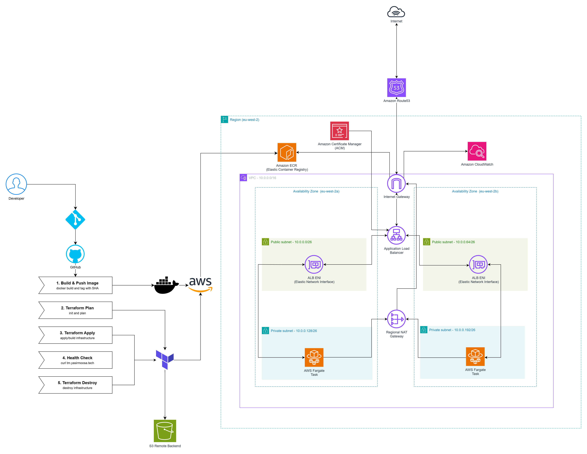

# Gatus on ECS Fargate

Gatus is an open source uptime and status page tool. You give it a list of endpoints and conditions (for example "returns 200 in under a second") and it checks them on a timer and shows a live dashboard. You can read more about it here: [TwiN/gatus](https://github.com/TwiN/gatus).

I took it and built out a full production-style deployment for it. It's containerised, running on ECS Fargate, sitting behind a load balancer with a real HTTPS domain, all built with Terraform and deployed through a CI/CD pipeline with no long lived AWS keys anywhere.


## Contents

- [Running the app locally](#running-the-app-locally)
- [The deployment](#the-deployment)
- [Architecture](#architecture)
- [Folder layout](#folder-layout)
- [CI/CD](#cicd)
- [Security and code quality scanning](#security-and-code-quality-scanning)
- [Proof of application working](#proof-of-application-working)
- [Successful pipeline runs](#successful-pipeline-runs)
- [CloudWatch dashboard](#cloudwatch-dashboard)
- [Architectural decisions](#architectural-decisions)
- [Future improvements](#future-improvements)
- [License](#license)

## Running the app locally

Clone the repo and run the exact image that gets deployed to ECS using Docker.

**Clone the repo**

```bash
git clone https://github.com/yasir-moosa/ecs-gatus-app.git
cd ecs-gatus-app
```

**With Docker**

Use the following commands to build the Docker image and run it as a container:

```bash
docker build -t gatus:local .
docker run --rm -p 8080:8080 gatus:local
```

Then open `http://localhost:8080`. You should see only the endpoints from `app/config.yaml`.

**Changing what gets monitored**

Edit `app/config.yaml`. Each endpoint has a URL, a check interval and a list of conditions that must all pass for it to show green:

```yaml
endpoints:
  - name: Google
    url: "https://google.com"
    interval: 1m
    conditions:
      - "[STATUS] == 200"
      - "[RESPONSE_TIME] < 1000"
```

The config is baked into the image at build time because Fargate can't mount a file from a local machine. Rebuild and push to change it.

## The deployment

Gatus runs as a Docker container inside ECS Fargate. Traffic comes in through an Application Load Balancer on port 443, gets terminated with a real ACM certificate and gets routed to whichever Fargate task is healthy at the time. There's no server to patch or SSH into, Fargate handles the compute for you.

Everything from the VPC up is created by Terraform.

## Architecture



- A VPC spanning two Availability Zones with public and private subnets in each
- A regional (multi-AZ) NAT Gateway so the Fargate tasks in the private subnets can pull the image from ECR and reach the internet (Gatus needs outbound access to run its checks) without needing one NAT Gateway per AZ
- An Application Load Balancer in the public subnets, listening on 80 and 443
- Port 80 just redirects straight to 443, nothing serves plain HTTP
- ECS Fargate service running 2 Gatus tasks in the private subnets
- ECR repository storing the built Docker image
- ACM certificate for `gatus.yasirmoosa.tech` is validated automatically through a DNS record in Route53
- Route53 hosted zone and A record pointing the subdomain at the load balancer
- S3 bucket holding the Terraform remote state
- A CloudWatch dashboard showing ECS CPU/memory, recent application logs and ALB request count/latency/5XX/healthy-host metrics in one place

## Folder layout

```
.
├── app/
│   └── config.yaml
├── Dockerfile
├── bootstrap/
│   ├── s3_bootstrap/
│   │   └── s3_bootstrap.tf
│   └── ecr_bootstrap/
│       ├── ecr_bootstrap.tf
│       └── ecr_variables.tf
│
├── infra/
│   ├── main.tf
│   ├── provider.tf
│   ├── variables.tf
│   ├── .tflint.hcl
│   └── modules/
│       ├── vpc/
│       ├── sg/
│       ├── alb/
│       ├── ecs/
│       ├── acm/
│       └── route53/
│
└── .github/
    └── workflows/
        ├── build-and-push.yml
        ├── terraform-deploy.yml
        ├── health-check.yml
        └── terraform-destroy.yml
```

Each module folder holds a `*_main.tf`, `*_variables.tf` and `*_outputs.tf`.

## CI/CD

There are four workflows and only one pair of them is actually chained together:

1. **Build and Push Image** runs automatically on a push that touches `app/` or the Dockerfile (or can be triggered manually). It lints the Dockerfile with **Hadolint** first (report-only for now), builds the image, runs a **Trivy vulnerability scan** against it (fails the job on any CRITICAL or HIGH severity fixable CVE so a vulnerable image never reaches ECR) then tags it with the commit SHA and pushes it to ECR.
2. **Terraform Deploy** is manual only, you trigger it from the Actions tab. It's split into two jobs: `terraform-plan` runs `init`, a TFLint pass, a Checkov scan and `plan`, saving the plan as an artifact. `terraform-apply` then requires manual approval (see [Security and code quality scanning](#security-and-code-quality-scanning)) before it downloads that exact plan and applies it. This way what gets applied is guaranteed to be what the plan showed, not a fresh plan that might have drifted and nothing reaches AWS without a deliberate approval click.
3. **Post-Deploy Health Check** runs automatically right after Terraform Deploy finishes successfully (or manually on its own). It waits 2 minutes for the ECS tasks to stabilize then curls the live site with up to 10 retries (30s apart) before failing, so it doesn't falsely fail on a service that's still starting up.
4. **Terraform Destroy** is manual only and requires typing the word "destroy" into a confirmation field before it'll run anything. It follows the same two-job pattern as Deploy. A `terraform-destroy-plan` job saves exactly what will be torn down then `terraform-destroy-apply` requires the same manual approval before it destroys it.

None of this uses long lived AWS access keys. GitHub Actions authenticates to AWS through OIDC (OpenID Connect). AWS trusts GitHub's identity provider directly and issues short lived credentials to a specific IAM role only when the workflow is running from this exact repo. No secrets to rotate or leak.

## Security and code quality scanning

- **Trivy** scans the built Docker image for OS and library vulnerabilities before it's pushed. Only fixable CRITICAL/HIGH findings block the pipeline so unfixable issues don't stall deployments.
- **TFLint** (with the AWS ruleset plugin) lints the Terraform code on every deployment for unused variables, missing provider/version constraints and AWS-specific best practices. Currently set to report-only, not blocking.
- **Checkov** scans the same Terraform code for IaC misconfigurations such as unencrypted resources, overly permissive security groups and missing logging in the same `terraform-plan` job. It's currently set to `soft_fail: true` so findings show up in the job logs but don't actually block a deployment.
- **Hadolint** lints the `Dockerfile` itself before it's built. Currently report-only similar to Checkov and TFLint.
- **Deployment approval**: `terraform-apply` (in **Terraform Deploy**) and `terraform-destroy-apply` (in **Terraform Destroy**) are gated by a `production` GitHub Environment with required reviewers. Both sit in a "Waiting" state until approved so nothing runs automatically. I'm currently the only reviewer so it's a self-approval gate for now but it still forces a deliberate step before anything reaches AWS.
- **Pinned actions**: Every third-party GitHub Action is pinned to its exact commit SHA and not a mutable tag. Each one has the version noted in the comment after it (e.g. `actions/checkout@11d5960a326750d5838078e36cf38b85af677262 # v4`). Tags like `v4` can be silently repointed to different code, which is how a real 2025 supply-chain attack on `tj-actions/changed-files` leaked secrets across thousands of repos ([you can read more about it here](https://www.wiz.io/blog/github-action-tj-actions-changed-files-supply-chain-attack-cve-2025-30066)). Pinning to the SHA guarantees the pipeline always runs the code that was actually verified.

## Proof of application working

URL used: `gatus.yasirmoosa.tech`


## Successful pipeline runs

### Docker Image Publish


### Terraform Plan + Apply


### Domain URL Health Check


### Terraform Plan + Destroy


## CloudWatch dashboard


## Architectural decisions

- The ALB has a `create_before_destroy` lifecycle rule on its target group. Without it, changing certain settings forces a replace and Terraform tries to delete the old target group while a listener still points at it which fails.
- The ECS task execution role is created by Terraform rather than assumed to already exist so the whole thing is reproducible in a fresh AWS account.
- The GitHub Actions IAM role currently has broad managed policies attached (EC2, ECS, S3, IAM, Route53, ACM, CloudWatch, ECR) rather than a tightly scoped custom policy. For a real production setup this should be narrowed down to only what's actually needed.
- Docker uses a multi-stage build. The first stage compiles Gatus from source, then only the compiled binary and the CA certificates get copied into an empty `scratch` image, so build tools and dependencies never make it into the final image.
- Gatus is built from source rather than using the official image because Trivy found 9 HIGH vulnerabilities in libraries compiled into the official binary (`grpc`, `x/net`, `x/image` and the Go standard library) and the latest release had no fix. Building from source lets me pin patched versions of those libraries and keep the Trivy scan blocking instead of bypassing it.
- OIDC is used across the pipeline so GitHub Actions gets short-lived AWS credentials scoped to a specific IAM role rather than long-lived access keys stored as secrets. The trust policy lists the exact repo subject for the `main` branch, the `production` environment and pull requests.
- The app runs on ECS Fargate rather than something like EKS. For a single container workload, Kubernetes' overhead (control plane, cluster management) isn't justified, Fargate provides serverless compute without needing to manage or patch servers.
- The domain's DNS stays in Route53 rather than a third-party provider which keeps ACM's DNS validation fully automatic since Route53 and ACM are natively integrated, no manual CNAME copying required.
- Terraform is split into separate modules (vpc, sg, alb, ecs, acm, route53) rather than one large file so each piece can be understood and changed independently.
- Each project gets its own state key in the shared S3 bucket (`ecs-gatus/app/terraform.tfstate`) so it can't overwrite another project's state.
- No AWS credentials are stored as GitHub Secrets at all, OIDC removes that requirement entirely so there's nothing sitting in the repo that could leak.

## Future improvements

- Scope down the single GitHub Actions IAM role into least-privilege, function-specific roles (build, deploy, destroy) instead of one role with broad managed policies attached.
- Move TFLint, Checkov, and Hadolint from report-only to blocking once the current findings are cleaned up.
- Add a second required reviewer for deployment approvals rather than the current self-approval setup.
- Run bootstrapping (the initial S3 backend and ECR repo creation) as its own pipeline, removing the manual first step before the rest of the infrastructure can deploy.
- Add a Terraform Plan workflow that runs on pull requests so reviewers see infra changes before they are merged.
- Add ECS Service Auto Scaling based on CPU/memory (or ALB request count) so the Fargate service can scale horizontally under load rather than running a fixed task count.
- Rename the leftover `threat-app` container, log group and dashboard names to `gatus-app`.

## License

Infra, CI/CD and Dockerfile are MIT licensed. Gatus is licensed under Apache License 2.0.
